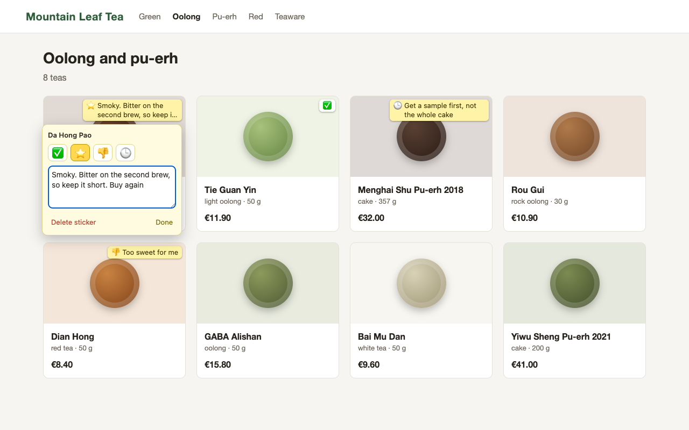
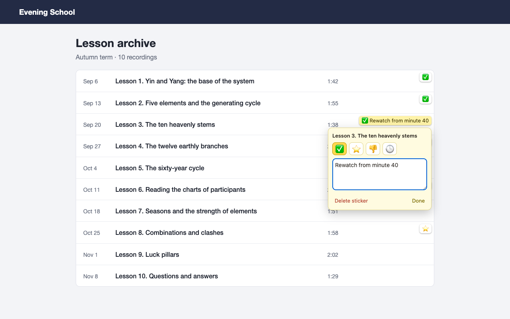

# List Stickers: sticky notes for any website

A Chrome extension that puts a private sticky note on anything you see on the
web: a tea in a shop, a lesson in a course, an article in a feed, or the page
itself.

- Mark an item in one click: ✅ done, ⭐ like, 👎 dislike, 🕒 for later.
- Write a note on it and find it there tomorrow, even after the list is sorted
  or filtered.
- Put a sticky note on a whole page, exactly where you clicked.
- Drag any sticker to where it does not cover what you want to see.
- Notes stay in your browser. No account, no sync, nothing sent anywhere.

## How to use

1. Right-click an item in any list.
2. Choose **List Stickers**, then **Add sticker to this list item**.
3. Pick a status, type a note. It saves as you type.

## Links

- [Source code and instructions](https://github.com/drew2a/list-stickers)
- [Report a problem](https://github.com/drew2a/list-stickers/issues)
- [Privacy policy](privacy)
